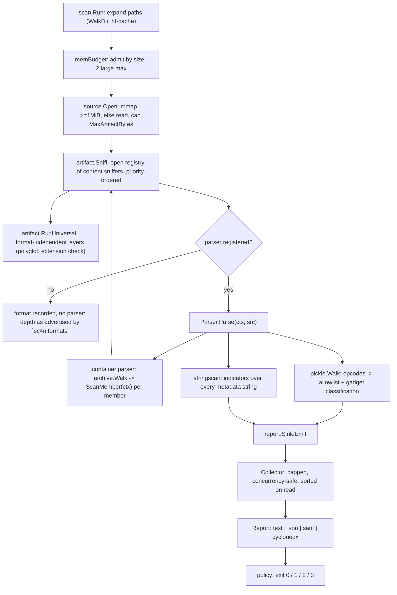

# sc4n architecture

## Pipeline



Two invariants hold across the whole graph:

1. **Nothing executes.** No parser calls an interpreter, a decompressor binary or
   an extracted file; `source` is the only place bytes enter, and an archive member
   reaches a parser three ways, none of which is "extracted": in memory when it is
   small, as a zero-copy section of the parent mapping when it is stored and large,
   or through a private unlinked temporary file that is mapped when it has to be
   decompressed first.
2. **A parser that fails is a finding, not a silence.** Any structural error
   becomes a finding at the offset where it happened, and the walk continues
   wherever continuing is meaningful. This is the counter to
   exception-oriented programming (arXiv 2508.19774) and to the modelscan
   fail-open ZIP iterator (issue #354), both of which turn "I could not read
   this" into "this is clean".

## Package layout

| package | responsibility |
|---|---|
| `internal/source` | the only byte entry point: mmap or buffered, hard cap, `Bytes` views valid until `Close` |
| `internal/limits` | the one budget struct every parser is threaded with, plus the `SC4N-LIMIT-*` rules |
| `internal/artifact` | content-based format dispatch, the parser registry, the session/context tree, the capability table |
| `internal/report` | finding model, rule registry, JSON/SARIF/CycloneDX encoders |
| `internal/scan` | worker pool, memory budget, deterministic merge, the `sc4n`-level rules for an incomplete scan |
| `internal/bytescan` | byte-level primitives shared by every parser: entropy, validated native magic, shebangs |
| `internal/pickle` | the pickle engine: opcode table, total walker, weights-only allowlist, gadget tables |
| `internal/stringscan` | the shared indicator engine (Aho–Corasick) applied to every string any parser materialises |
| `internal/archive` | zip/tar/single-stream compression walking, with fail-closed member iteration, section/spill member sources and CRC validation |
| `internal/polyglot`, `internal/native` | the universal layer: validated native headers anywhere in a bounded head/tail window, container signatures, shebangs, extension mismatch |
| `internal/safetensors`, `internal/gguf`, `internal/onnx`, `internal/tfmodel` | the deep model formats: header validation, metadata walking, external-data containment, template and class-allowlist rules |
| `internal/torch`, `internal/numpy`, `internal/msgpack`, `internal/xgb`, `internal/coreml`, `internal/pte` | the remaining runtimes, each recognising its shapes by content |
| `internal/pysrc`, `internal/repo`, `internal/content` | Python source and notebooks, install/startup hooks in a repository, and the JSON/text/metadata layer that routes cards, tokenizers, templates and HF config files |
| `internal/jinja`, `internal/tokenizer`, `internal/cards` | the template, tokenizer-pattern and card analysers the content layer calls |
| `internal/policy` | exit-code verdicts and baseline suppression |
| `internal/hfcache` | the Hugging Face cache expander: symlink resolution, revision labels, blob de-duplication |
| `internal/formats` | blank-imports every parser package so a binary states what it contains |
| `cmd/sc4n` | flag parsing, output selection, exit codes |

## The parser contract

```go
// internal/artifact
type Parser interface {
    Parse(ctx *Ctx, s source.Source) error
}

type Ctx struct {
    Session *Session       // shared: collector, root, deep-stats, blob memo
    Sink    *report.Sink   // findings are emitted here; the artifact name is bound
    Limits  limits.Limits  // the budget for this nesting level
    Depth   int            // 0 at the top
    Format  Format         // what this level sniffed as
}

// A container parser recurses with this, so naming, depth accounting and the
// depth budget are implemented exactly once. It takes a Source rather than bytes
// because a member can be larger than memory: the three paths above are all
// Sources. ScanMemberBytes is the convenience wrapper for a member already in
// hand.
func ScanMember(parent *Ctx, name string, s source.Source) (Format, error)
func ScanMemberBytes(parent *Ctx, name string, data []byte) (Format, error)
```

Registration, from a format package's `init`:
```go
artifact.RegisterFormat(artifact.Info{Format: ..., Magic: ..., Depth: ..., Container: ..., Notes: ...})
artifact.RegisterSniffer("name", priority, func(s source.Source, l limits.Limits) (artifact.Format, bool))
artifact.RegisterParser(artifact.FormatX, parser{})
artifact.RegisterUniversal("polyglot", func(ctx *artifact.Ctx, s source.Source, f artifact.Format) { ... })
```

Three rules govern what a sniffer may claim, and each exists because the
alternative was a silent miss: an artifact whose format nothing claimed has no
parser and no indicator pass, so its finding list is empty and reads exactly like
a clean file's.

- **A bare native magic is not a program.** The magic sniffer asks the validator
  `internal/polyglot` registers (`artifact.RegisterNativeValidator`); when the
  header does not validate, the claim is remembered and the next sniffer gets its
  turn, so a chat template or a `config.json` that begins with `MZ` is still parsed
  as what it is, and the bare magic is reported at info
  (`SC4N-POLYGLOT-MAGIC-ONLY`). The last-resort text classifier does not override
  that claim, because an unvalidated `.so` is closer to a program than to a
  document. `FAT_MAGIC` is recognised (debug/macho reads that variant);
  `FAT_CIGAM` and `FAT_MAGIC_64` are not, because the standard library cannot read
  them and calling a file a program with no header to check would be a lie.
- **A text artifact with binary appended is still text.** A NUL in the first
  kilobyte disqualifies the text classifier *unless* the artifact opens as a
  document (64 or more printable bytes), in which case it is claimed as text and
  the content layer reports `SC4N-CONTENT-NOT-UTF8` while still running the
  byte-safe indicators over the whole buffer. Binary content that starts
  immediately, and random bytes, stay unclaimed.
- **A claim must survive the walk it promises.** The pickle sniffer accepts a
  stream after a silent probe walk reaches STOP, after 8 or more opcodes of a
  protocol-bearing stream, or when the walk ran cleanly up to the 256 KiB probe
  budget — and it also looks for a protocol byte inside a 64-byte prefix, because
  a prefix in front of a stream is the nullifAI shape. A probe that refuses a file
  it could have walked is indistinguishable from a clean file.

Rules are declared once and referenced by pointer, so a rule's severity, CWE and
help text cannot disagree between `sc4n rules`, the JSON report and the SARIF
descriptor:

```go
var ruleThing = report.DefineRule(report.Rule{
    ID: "SC4N-...", Title: "...", Severity: report.SeverityHigh,
    Confidence: report.ConfidenceHigh, CWE: []string{"CWE-502"}, Class: "...",
    Description: "...", Refs: []string{"https://..."},
})

ctx.Sink.Emit(ruleThing, offset, "evidence")
ctx.Sink.EmitExtra(ruleThing, offset, "evidence", map[string]string{"key": "value"})
ctx.Sink.EmitAt(ruleThing, line, col, "evidence")   // for source analysis
```

`report.DefineRule` panics on a malformed or duplicate rule. That is deliberate:
an ID collision would make one of two detectors invisible in `sc4n rules` and
mis-described in SARIF, and a panic during a test run is a cheaper failure than a
silently missing catalogue entry.

## Adding a format

1. Pick the `Format` value (add one to `internal/artifact/format.go` if the family
   is new) and add the extension mapping there if the extension is diagnostic.
2. Create `internal/<format>/` with `parser.go` (registration, sniffer, parser),
   `rules.go` (`DefineRule` calls with the CVE/paper references in the
   description), and the parsing files.
3. Add `internal/formats/<format>.go` containing only
   `package formats` and a blank import of the new package, so the CLI links it.
4. Add `tools/sc4nfixtures/<format>_fixtures.go`: a `contributor` with the fixture
   bytes and the expectation maps. Fixtures are generated in Go and never
   downloaded; each one's doc comment names the attack it reproduces.
5. Run `make fixtures && go test ./internal/... -run TestFixtureExpectations`.
   The corpus test also fails when a fixture on disk has no expectation entry, so
   a new fixture cannot be added without stating what it is for.
6. If the format produces informational statistics, gate them behind
   `ctx.Session.DeepStats`.

## Limits

| limit | default | why this value |
|---|---|---|
| `MaxArtifactBytes` | 64 GiB | larger than any published single-file checkpoint |
| `MaxHeaderBytes` | 100 MiB | mirrors the safetensors reference implementation's own cap |
| `MaxDepth` | 4 | deepest legitimate nest observed: joblib→object pickle, zip→pickle, tar→pickle |
| `MaxEntries` | 100 000 | far above any real archive, far below a member-count DoS |
| `MaxArrayElements` | 1<<22 | one metadata array (tokenizer vocab, UBJSON/MessagePack array); above every published vocabulary (Llama-3 is 128 256, Qwen 151 936) and still bounds the walk |
| `MaxDecompressedBytes` | 8 GiB | per archive; a real model's members sum below this |
| `MaxRatio` | 200 | above real model compression (tokenizer JSON reaches ~20:1), below a zip bomb |
| `MaxStringBlob` | 16 MiB | one metadata value, tokenizer entry or embedded JSON |
| `MaxSpillBytes` | 4 GiB | one archive member materialised on disk for parsing; above every published single-member shape, below a decompression bomb that fills the temporary filesystem |
| `MaxRetainedText` | 64 MiB | total text one artifact's parse keeps alive; per-value caps alone still let a million small values add up |
| `MaxHashBytes` | 256 MiB | how much of an artifact the scan digests — see the performance section for why a full digest of a 13 GiB checkpoint cannot fit the budget |
| `MaxFindings` | 100 000 | a crafted artifact must not exhaust memory; a drop is reported |
| `MaxStackDepth` | 1<<20 | a real state_dict builds a stack a few hundred deep |
| `MmapThreshold` | 1 MiB | below this, mapping costs more than reading |

Every one of these, when hit, is an `SC4N-LIMIT-*` finding naming the limit and
the observed value. Silent truncation is never acceptable: a scanner that stops
early and says nothing is indistinguishable from one that found nothing.

Two of them are worth reading as design notes rather than as caps:

- **`MaxSpillBytes`** exists because a member can be larger than memory. A
  *stored* zip member above `MaxStringBlob` is handed to the parser as a
  zero-copy section of the parent mapping; a *compressed* one is decompressed into
  a private temporary file that is unlinked before it is mapped, so a 4 GiB
  member inside a `.pt` is parsed by the same random-access parsers that read a
  top-level file, and its CRC-32 is still validated (at close, by streaming the
  member once — the parser may have read only a header).
- **`MaxHashBytes`** exists because sha256 is CPU-bound on this class of host.
  Measured: 0.35 GB/s (the reference CPU has AVX2 but no SHA-NI), so a full digest
  of a 13 GiB artifact costs ~37 s — more than the entire scan budget — while the
  digest is only an identity, not a verdict. Above the cap the report carries
  `sha256Scope: "prefix:<bytes>"`; `sc4n hash <path>` is the command that
  computes a full sha256 when one is actually needed.

## Performance

Measured on the reference host (8 cores, 14 GiB RAM, `go1.27.0 linux/amd64`),
`make bench` for the kernels and `make bench-big` for the end-to-end gate. The
budget column is what the plan set; the measured column is what the tree does
today, with the honest gaps marked.

| path | budget | measured | note |
|---|---|---|---|
| pickle walk, opcode-dense state_dict (4000 entries × 256 B) | ≥ 300 MB/s/core | **359 MB/s**, 14719 allocs/1.2 MB | per-opcode cost, not per-byte |
| pickle walk, blob-dense (16 × 64 KiB constants) | — | **20 GB/s** | this is the shape a real torch storage pickle has |
| entropy pass (256-bin count, full file) | ≥ 1 GB/s/core | **1.0-1.2 GB/s**, 0 allocs | the full-file pass, `bytescan.Entropy`, measured by `BenchmarkEntropy` |
| indicator engine over prose + indicators | ≥ 1 GB/s/core | **131 MB/s** | **not met** — see below |
| — of which: Aho–Corasick literals | — | 220 MB/s | one dependent load chain per byte |
| — of which: Unicode anomaly walk | — | 550 MB/s | ASCII fast path, `utf8.DecodeRune` only for non-ASCII |
| — of which: raw-IP URL hunt | — | 2.2 GB/s | two single-anchor `bytes.IndexByte` passes |
| validated-native search over random bytes | — | 338 MB/s | header validation, not a byte scan |
| safetensors header + metadata | ≥ 1 GB/s | 7 µs per header | the file's *body* is not read |
| end-to-end 13.00 GiB F16 safetensors | ≤ 20 s wall, ≤ 512 MiB RSS | **1.25 s wall (10.4 GiB/s), 7.8 MiB anonymous RSS** | `make bench-big` |
| `-hf-cache` over a synthetic two-revision cache | — | one scan per unique blob | `TestHFCacheScansEachBlobOnce` |

### The one budget that is not met, and why

The plan asked for a full-file string/entropy scan at ≥ 1 GB/s per core. The
entropy pass meets it (1.0-1.2 GB/s, `BenchmarkEntropy`). The indicator engine does
not: a byte-at-a-time Aho–Corasick walk is a *dependent* chain — the transition for
byte *i+1* cannot start until byte *i*'s table load has completed — and that chain
costs about 4.5 ns per byte on this CPU regardless of how the table is laid out. The
obvious encoding (`[256]int32` per node) was measured at 74 MB/s; class-compressing
the goto table so that only the ~70 bytes that actually occur in an indicator get a
column, and materialising fail transitions so the walk has no fail loop, brought it
to 220 MB/s; the ASCII fast paths in the Unicode and URL scanners removed the two
scanners that were *slower* than the automaton.

What is not on that path, and why the end-to-end number is what it is: the
indicator engine runs over *text* — metadata values, config JSON, source, cards,
templates — which is tens of megabytes in a real repository, while the tensor
bodies that make up 99% of a checkpoint are only ever streamed for the digest:
their headers are parsed and bounded, and a weight statistic is computed over a
sample only when `-deep-stats` is passed. That is why 13 GiB scans in 1.25 s even
though the string engine is 8x off its per-core target. Closing the gap needs SIMD literal matching
(a Teddy/FDR-style nibble-shuffle engine), which is a project in itself and is
recorded here rather than pretended away.

### Two measurement notes

**Resident memory is measured as anonymous RSS, not VmHWM.** A memory-mapped
artifact's pages are charged to the process's RSS while the kernel holds them in
the page cache, so VmHWM grows to the artifact size (272 MiB on the 13 GiB run)
even though the process never owns those bytes and the kernel may reclaim them
under pressure. `RssAnon` — 7.8 MiB on the same run — is the number that answers
"did the scanner materialise the artifact". Both are reported by
`make bench-big`; the budget is asserted against the anonymous figure, and the
threat model states the same distinction.

**The digest is capped, and says so.** `sha256Scope` is `full` below
`MaxHashBytes` and `prefix:<bytes>` above it. A prefix digest presented as a file
digest would be exactly the kind of silent truncation the rest of this tool
refuses to do, so the scope travels with the value in JSON and — for a prefix —
as a pair of `sc4n:sha256`/`sc4n:sha256Scope` properties in CycloneDX rather than
as a component `hashes` entry, which is a claim about the whole component.

The budgets are properties of the design rather than hopes: an artifact is mapped
once, its digest is computed concurrently with the parse, the indicator engine is
one Aho–Corasick pass over a buffer instead of N `regexp` calls, and no parser
materialises more than a bounded slice of an attacker-controlled length.

Two experimental accelerators were permitted but never required, each behind a
build tag with a pure-stdlib counterpart and each shipped only if `make bench`
showed at least 1.5× on its own kernel. **Neither is shipped**, and the reasons are
measurements rather than opinions:

- **SIMD byte-class histogram** (`goexperiment.simd`, `simd/archsimd`): evaluated,
  dropped, and then deleted. No detector reads a byte-class histogram — the entropy
  pass over the same bytes is `bytescan.Entropy`, whose 256-bin count runs at
  1.0-1.2 GB/s — and the string engine's bottleneck is the automaton's dependent load
  chain, which a histogram kernel does not touch. Measured before it was removed, the
  histogram itself ran at 0.10 GB/s on tensor-body bytes and 0.53 GB/s on prose: an
  order of magnitude below the ≥ 1 GB/s budget, with no caller that wanted it. There
  was nothing for a SIMD kernel to accelerate, so the kernel is gone from the tree
  and this note is the record of why.
- **`encoding/json/v2` header decoding** (`goexperiment.jsonv2`): the header decode
  is microseconds per artifact against a scan dominated by I/O and hashing, so no
  end-to-end win was measurable.

`make test-simd` remains in the tree: it proves the whole module still builds and
passes under `GOEXPERIMENT=simd` (and under the emulated `GODEBUG=simd=0` pass),
which is where a future kernel would have to live.

## Calibration against a real corpus

Every calibration claim in this document and in the threat model is meant to be
re-measurable, so the method is recorded here with the numbers of the round that
produced them. The corpus is the Hugging Face campaign of 2026-10-10 (273 models,
2688 fetched artifacts, 1209.8 MiB; the harness is in
`local://sc4n-hf-campaign-2026-10-10.md` — re-fetch into a scratch directory, scan
that directory with both binaries, and diff the raw JSON per
`(artifact, ruleId, offset, evidence)`).

Round of 2026-10-15, the same corpus and the same 2688 artifacts:

| rule | before | after | why it changed |
|---|---|---|---|
| `SC4N-GGUF-STRUCT` | 9270 | 287 | one truncation, one fact: the first past-EOF tensor is reported by name, the remaining 881 are one aggregate finding (truncated files are 256 of the 2688 artifacts) |
| `SC4N-ONNX-CUSTOM-DOMAIN` | 100 | 5 | one finding per distinct `(domain, kind)` instead of one per node |
| `SC4N-STRING-SECRET-VALUE` | 11 | 0 | every hit was an assignment-shaped placeholder in a model card (`OPENAI_API_KEY="EMPTY"`, `'your-api-key'`, `$HF_TOKEN`), each verified by reading its context |
| `SC4N-STRING-RAW-IP-URL` | 10 | 10 | unchanged count, evidence now names the notation (dotted-decimal, hex, octal, integer) |
| **all rules** | **10733** | **1644** | 14 critical → 14, 107 high → 96, 9966 medium → 888, 53 low → 53, 593 info → 593 |

Two properties are asserted rather than eyeballed: the report is byte-identical
across two consecutive scans of the corpus (determinism), and no `high` or
`critical` finding disappears except the class named in the table — the round's own
differential prints that check, and it is why the removed set is small enough to
read.

The false negatives fixed in the same round cannot be seen in a before/after of a
corpus that contains none of those shapes, so they are pinned by fixtures instead:
a text artifact with a NUL appended (dispatched `unknown`, empty finding list
before; text, `SC4N-CONTENT-NOT-UTF8` plus the byte-safe indicators after), a chat
template behind a bare `MZ` magic (native, no template analysis before; the
template's own rules after), and a pickle behind a prefix or behind a constant
larger than the probe budget (no finding before; the critical gadget finding
after). Each has a fixture in `testdata/fixtures/` whose `expect` list is the
contract.
