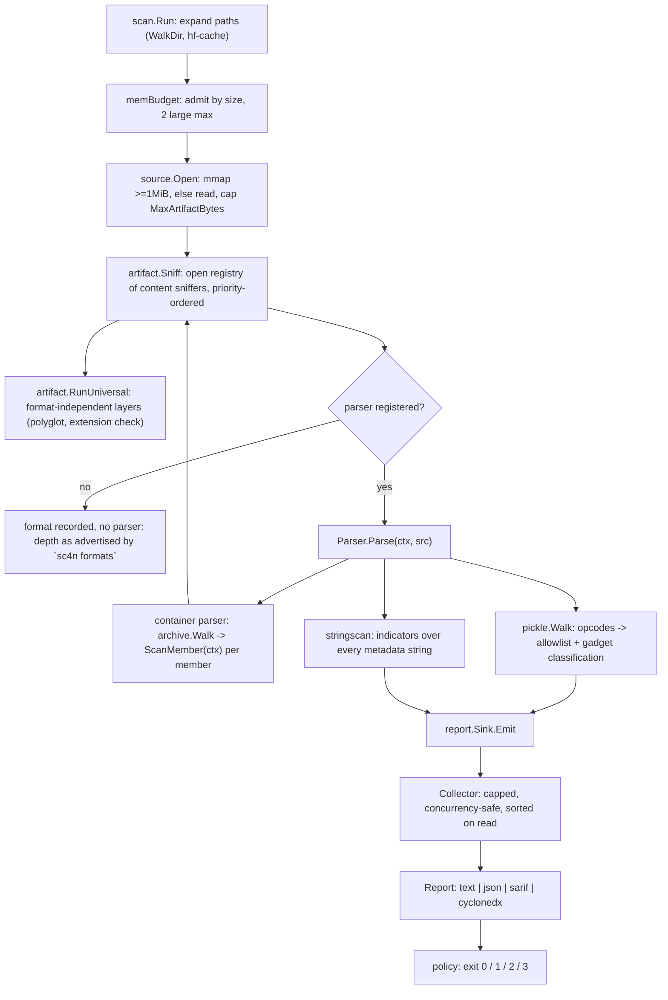

# sc4n architecture

## Pipeline



Two invariants hold across the whole graph:

1. **Nothing executes.** No parser calls an interpreter, a decompressor binary or
   an extracted file; `source` is the only place bytes enter, and archive members
   are parsed from memory or `io.ReaderAt`.
2. **A parser that fails is a finding, not a silence.** Any structural error
   becomes a finding at the offset where it happened, and the walk continues
   wherever continuing is meaningful. This is the counter to
   exception-oriented programming (arXiv 2508.19774) and to the modelscan
   fail-open ZIP iterator (issue #354), both of which turn "I could not read
   this" into "this is clean".

## Package layout

| package | responsibility |
|---|---|
| `internal/source` | the only byte entry point: mmap or buffered, hard cap, `Bytes` views valid until `Close` |
| `internal/limits` | the one budget struct every parser is threaded with, plus the `SC4N-LIMIT-*` rules |
| `internal/artifact` | content-based format dispatch, the parser registry, the session/context tree, the capability table |
| `internal/report` | finding model, rule registry, JSON/SARIF/CycloneDX encoders |
| `internal/scan` | worker pool, memory budget, deterministic merge, the `sc4n`-level rules for an incomplete scan |
| `internal/bytescan` | byte-level primitives shared by every parser: entropy, validated native magic, shebangs |
| `internal/pickle` | the pickle engine: opcode table, total walker, weights-only allowlist, gadget tables |
| `internal/stringscan` | the shared indicator engine (Aho–Corasick) applied to every string any parser materialises |
| `internal/archive` | zip/tar/single-stream compression walking, with fail-closed member iteration |
| `internal/*` (formats) | one package per format family, each registering a sniffer, a parser and its capability row |
| `internal/formats` | blank-imports every parser package so a binary states what it contains |
| `cmd/sc4n` | flag parsing, output selection, exit codes |

## The parser contract

```go
// internal/artifact
type Parser interface {
    Parse(ctx *Ctx, s source.Source) error
}

type Ctx struct {
    Session *Session       // shared: collector, root, deep-stats, blob memo
    Sink    *report.Sink   // findings are emitted here; the artifact name is bound
    Limits  limits.Limits  // the budget for this nesting level
    Depth   int            // 0 at the top
    Format  Format         // what this level sniffed as
}

// A container parser recurses with this, so naming, depth accounting and the
// depth budget are implemented exactly once.
func ScanMember(parent *Ctx, name string, data []byte) (Format, error)
```

Registration, from a format package's `init`:

```go
artifact.RegisterFormat(artifact.Info{Format: ..., Magic: ..., Depth: ..., Container: ..., Notes: ...})
artifact.RegisterSniffer("name", priority, func(s source.Source, l limits.Limits) (artifact.Format, bool))
artifact.RegisterParser(artifact.FormatX, parser{})
artifact.RegisterUniversal("polyglot", func(ctx *artifact.Ctx, s source.Source, f artifact.Format) { ... })
```

Rules are declared once and referenced by pointer, so a rule's severity, CWE and
help text cannot disagree between `sc4n rules`, the JSON report and the SARIF
descriptor:

```go
var ruleThing = report.DefineRule(report.Rule{
    ID: "SC4N-...", Title: "...", Severity: report.SeverityHigh,
    Confidence: report.ConfidenceHigh, CWE: []string{"CWE-502"}, Class: "...",
    Description: "...", Refs: []string{"https://..."},
})

ctx.Sink.Emit(ruleThing, offset, "evidence")
ctx.Sink.EmitExtra(ruleThing, offset, "evidence", map[string]string{"key": "value"})
ctx.Sink.EmitAt(ruleThing, line, col, "evidence")   // for source analysis
```

`report.DefineRule` panics on a malformed or duplicate rule. That is deliberate:
an ID collision would make one of two detectors invisible in `sc4n rules` and
mis-described in SARIF, and a panic during a test run is a cheaper failure than a
silently missing catalogue entry.

## Adding a format

1. Pick the `Format` value (add one to `internal/artifact/format.go` if the family
   is new) and add the extension mapping there if the extension is diagnostic.
2. Create `internal/<format>/` with `parser.go` (registration, sniffer, parser),
   `rules.go` (`DefineRule` calls with the CVE/paper references in the
   description), and the parsing files.
3. Add `internal/formats/<format>.go` containing only
   `package formats` and a blank import of the new package, so the CLI links it.
4. Add `tools/sc4nfixtures/<format>_fixtures.go`: a `contributor` with the fixture
   bytes and the expectation maps. Fixtures are generated in Go and never
   downloaded; each one's doc comment names the attack it reproduces.
5. Run `make fixtures && go test ./internal/... -run TestFixtureExpectations`.
   The corpus test also fails when a fixture on disk has no expectation entry, so
   a new fixture cannot be added without stating what it is for.
6. If the format produces informational statistics, gate them behind
   `ctx.Session.DeepStats`.

## Limits

| limit | default | why this value |
|---|---|---|
| `MaxArtifactBytes` | 64 GiB | larger than any published single-file checkpoint |
| `MaxHeaderBytes` | 100 MiB | mirrors the safetensors reference implementation's own cap |
| `MaxDepth` | 4 | deepest legitimate nest observed: joblib→object pickle, zip→pickle, tar→pickle |
| `MaxEntries` | 100 000 | far above any real archive, far below a member-count DoS |
| `MaxDecompressedBytes` | 8 GiB | per archive; a real model's members sum below this |
| `MaxRatio` | 200 | above real model compression (tokenizer JSON reaches ~20:1), below a zip bomb |
| `MaxStringBlob` | 16 MiB | one metadata value, tokenizer entry or embedded JSON |
| `MaxFindings` | 100 000 | a crafted artifact must not exhaust memory; a drop is reported |
| `MaxStackDepth` | 1<<20 | a real state_dict builds a stack a few hundred deep |
| `MmapThreshold` | 1 MiB | below this, mapping costs more than reading |

Every one of these, when hit, is an `SC4N-LIMIT-*` finding naming the limit and
the observed value. Silent truncation is never acceptable: a scanner that stops
early and says nothing is indistinguishable from one that found nothing.

## Performance

Measured on the reference host (8 cores, 14 GiB RAM), `make bench`:

| path | budget |
|---|---|
| pickle walk | ≥ 300 MB/s/core |
| safetensors header + metadata | ≥ 1 GB/s |
| string/entropy scan | ≥ 1 GB/s/core |
| end-to-end 13 GB F16 safetensors | ≤ 20 s wall, ≤ 512 MiB RSS |

The budgets are properties of the design rather than hopes: an artifact is mapped
once, its digest is computed concurrently with the parse, the indicator engine is
one Aho–Corasick pass over a buffer instead of N `regexp` calls, and no parser
materialises more than a bounded slice of an attacker-controlled length.

Two experimental accelerators are permitted but never required — the SIMD
byte-class kernel (`goexperiment.simd`) and `encoding/json/v2`
(`goexperiment.jsonv2`) — each behind a build tag with a pure-stdlib counterpart,
and each shipped only if `make bench` shows at least 1.5× on its own kernel.
